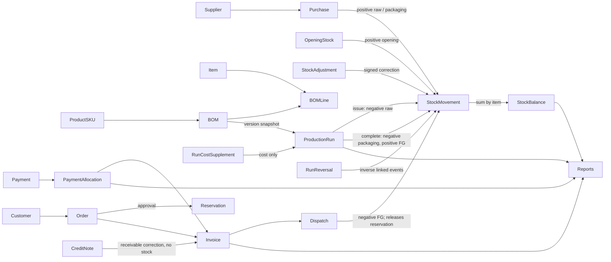

# Decisions and design baseline

19 November 2026. Based on the supplied problem statement (PS), especially §§4–7. These are project decisions, not organizer answers. A reply that changes a decision must also update the requirements and golden workbook. The PS is source material; it does not authorize sending email or publishing this repository.

| ID | Decision | Reason / consequence |
| --- | --- | --- |
| DEC-01 | Moving weighted-average material valuation at each receipt; snapshot issue value | Flour (100×42 + 60×45)/160 = ₹43.125/kg, so 40 kg costs ₹1,725; later receipts cannot rewrite past issues. |
| DEC-02 | Allocate entered run overhead over good output only | ₹1,800/188 absorbs loss into saleable output; zero good output leaves cost unallocated for review. |
| DEC-03 | Benchmark cost ₹5,855/188 = ₹31.143617…; display ₹31.14 and margin ₹18.86 | Includes ₹4,055 materials/packaging and ₹1,800 overhead; margin is ₹50 minus unrounded cost, excluding GST. |
| DEC-04 | Yield = (good−expected)/expected; consumption = (actual issued−BOM standard)/standard | Standard scales by planned batches, not actual good output; default tolerance 3%, flag absolute variance strictly greater than tolerance; zero standard gives N/A. |
| DEC-05 | Record 9 cartons exactly, with a packaging exception note | 188 packets require 10 cartons if all packed; 9 cartons hold 180, leaving 8 loose packets. Do not silently consume a tenth carton. |
| DEC-06 | Record 12 unclassified packet-equivalents of yield shortfall; separately record 6 damaged pouches | Expected 200 minus good 188 is 12; the PS does not establish damaged food quantities or a cause. Do not split this into 6 + 6 or deduct any extra stock. |
| DEC-07 | Actual pouch issue = 188 used + 6 damaged = 194 | The explicit benchmark closing balance is 306; 200 is the plan, not actual issue. Damaged packaging is tracked separately from food loss. |
| DEC-08 | Available FG = on hand − approved but undispatched reservations | Approval reserves atomically; invoicing retains reservation; dispatch reduces both physical stock and reservation, avoiding overselling. |
| DEC-09 | B remains `submitted` with a computed shortage flag; no partial approval, invoice or dispatch | 120 requested against 88 available shows shortage 32; after replenishment, admin may approve. "Pending stock" is explanatory text, not a new lifecycle status. Rejection is an explicit, terminal `rejected` outcome with an admin reason; it is distinct from insufficient stock. |
| DEC-10 | Invoice creates receivable; dispatch alone moves FG | Documents have different accounting and physical effects; reports use commercial documents as well as stock movements. |
| DEC-11 | Drafts editable with audit; posted events immutable | Invoice correction uses linked credit note; production uses linked reversal and replacement. A credit note alone does not restore physical stock. Reject reversal if dependent stock would become negative until dependencies are resolved. |
| DEC-12 | Money totals in integer paise; quantities in integer g, ml or pieces | Preserve weighted-average unit rates as exact ratios/high-precision decimals: ₹43.125/kg cannot be rounded to paise/kg before multiplication. Round monetary postings half-up once, allocate any residual paise explicitly. |
| DEC-13 | Prototype supply state defaults from customer GSTIN prefix (33 TN, 29 Karnataka); explicit state required without GSTIN | Factory state is 33; same-state uses CGST/SGST, other-state IGST under this exercise. This is a benchmark simplification, not a general legal place-of-supply rule. Tax rate is PS's assumed 5%; HSN/GSTIN use clearly dummy fixture values. |
| DEC-14 | Step 2 posts a material-issue event; step 3 posts completion and packaging issue under the same run | Raw issues happen once at step 2; completion consumes 194 pouches and 9 cartons and receives 188 FG. Run has draft → issued → completed states; each event is atomic/idempotent. No separate WIP stock item in this scope. |
| DEC-15 | Step 8 creates a linked overhead/cost supplement | Late overhead cannot edit existing movements. Cost report moves from provisional materials-only ₹4,055 to final ₹5,855; any eventual inventory valuation adjustment must be a separate auditable value-only event. |
| DEC-16 | Opening FG valuation unknown; no invented opening cost or COGS | PS provides 50 opening packets without a rate. Workbook tests quantities and new-run cost, not aggregate FG valuation or realized accounting profit. |
| DEC-17 | Invoice date is default due date; configurable customer credit days | Ageing uses as-of date minus due date, with current/1–30/31–60/61–90/91+ buckets. Fixture dates are 19 November 2026, so ₹3,875 is current on that date. |
| DEC-18 | Tax calculated per invoice line, half-up to paise; FY April–March | Persist rounded line components and sum them; unique numbering allocated on posting, never reused. Benchmark tax split is exact. |
| DEC-19 | No negative physical stock; reserve and post under transaction locking | Recheck at approval/dispatch/issue, including concurrent requests. Draft edits require renewed approval if they change an approved order. |
| DEC-20 | Sole stretch: shortage-based production suggestion | Use ceil(total uncovered pending demand / BOM expected yield), deduct existing reservations once; B suggests 1 batch (200 expected). Feasible full batches = floor(min(available input / standard per batch)) across raw and packaging inputs. Remaining stock allows 1 batch; 250 uncovered packets need 2, short by 0.5 L oil and 94 pouches. Show needs, stock and warning; never automatically post or reduce the demand-based suggestion. STR-4 is subject to the requirements cut line. |
| DEC-21 | Product-specific carton conversion, separate carton material | A carton sale unit means 20 packets for this SKU; it is not a second automatic packaging-material deduction at dispatch. No mass-to-volume conversion without an explicit item rule. |
| DEC-22 | Run-specific costing first; no month-wide overhead allocation or integrated general ledger | Satisfies the allowed per-run rule and keeps the benchmark explainable; purchase tax is unspecified and is not invented. |
| DEC-23 | Stock postings append in a server-assigned sequence, never into earlier valuation history | One factory-wide transaction lock serializes stock posting and sequence allocation; all lines of an event share the sequence. Document dates are metadata and cannot reorder valuation; no historical replay or back-insertion. Reversals append at the current sequence with original signed quantities/values negated. |

| DEC-24 | Test-only 500 g SKU shares the raw recipe, not its packaging | One recipe expects 200 × 200 g packets or 80 × 500 g packets: 40 kg nominal packaged output, not a mass balance inferred from ingredients. The test uses a separate 500 g pouch and assumes a carton holds 20 larger packets. This SKU is not loaded by the benchmark seed. |
| DEC-25 | Round the total issue value, retain the residual in remaining stock, consume all value on depletion | Value = ROUND_HALF_UP(remaining paise × issue base quantity / remaining base quantity), using an exact Fraction. A 3 g/10 paise balance issues 1 g at 3 paise, leaving 2 g/7 paise; another 1 g costs 4 paise, leaving 1 g/3 paise; depletion takes the final 3 paise. Never round the unit rate first. |
| DEC-26 | Variance reports use the current tolerance retroactively | Store tolerance in integer basis points (300 = 3%); flag absolute exact variance strictly greater than tolerance. Changing to 200 flags historical −3% pouch usage without changing the run, movements or historical quantities. Settings changes record actor, time and old/new tolerance. |
| DEC-27 | FG receipt value is materials-only; overhead stays in the run-cost report | Completion receives good output at actual raw plus packaging cost. Later immutable overhead documents update total run cost and cost per good packet without editing FG movements. Zero good output creates no FG receipt; run cost remains visible and unit cost is N/A. |

## One-page domain sketch

| Group | Entities and meaning |
| --- | --- |
| Masters | **Item:** stock identity/category/base unit. **UnitConversion:** item-specific rational multiplier. **Product/SKU:** saleable item, pack size, price and tax metadata. **BOM/BOMLine:** versioned recipe, expected yield and standard inputs. **Customer:** sales identity, state and credit terms. **Supplier:** receipt counterparty. |
| Documents | **Purchase/PurchaseLine:** receipt and rate. **ProductionRun/RunIssue/RunOutput:** recipe snapshot, actual inputs, good output and loss. **RunCostSupplement:** later overhead. **Order/OrderLine:** demand, approval and reservation. **Invoice/InvoiceLine:** numbered receivable/tax snapshot. **Dispatch/DispatchLine:** physical fulfillment. **Payment/PaymentAllocation:** receipt applied to invoice. **CreditNote:** invoice correction. **OpeningStock/StockAdjustment:** explicit opening or correction reason. **RunReversal:** inverse of identified run events. |
| Ledger | **StockMovement:** item, signed base quantity, exact unit-cost snapshot where known, source type/ID/line, event ID and posting time; immutable and unique per posting event/line. Opening FG cost may be unknown. Cost supplements hold value without pretending quantity moved. |
| Control | **User/Role:** server-side permissions and salesman ownership. **AuditLog:** actor, time, action, before/after, document reference. **Reservation:** approved order-line quantity awaiting dispatch; **Settings:** tolerance and numbering policy. |

Each document has many lines; each movement belongs to exactly one item and one source event/line. A SKU references one stock item and many versioned BOMs; each run selects one BOM snapshot. Customers have many orders/invoices; dispatch lines reference invoice lines; payment allocations join payments to invoices. Roles have many users; every mutation records its user in AuditLog. This is a conceptual relationship/flow sketch, to be refined into the eventual ≤2-page design note.

Stock is the sum of signed movements. BOM quantities scale by planned batches; actual issues drive stock and cost. Weighted issue values plus actual packaging plus overhead, divided by good output, give run unit cost. Reservations affect availability, never on-hand stock. The accepted stack is Django with PostgreSQL and server-rendered pages, run locally with Docker Compose; hosted delivery is deferred.

## Questions email — draft only, not sent

**To:** Organizer contact, not yet confirmed. **Subject:** Winter Internship 2026 — benchmark and questions-window clarification

Dear CDI internship organizers,

I am preparing the Order-to-Audit prototype. Section 10 of my problem statement still contains date/contact placeholders. Please confirm the questions-window closing date/time (IST), questions email, submission deadline and where shared answers will appear.

1. Should we record exactly 9 cartons for the 188 good packets, noting that 8 packets remain loose and fully packing the output would need 10 cartons?
2. Does “6 pouches damaged” also mean 6 food packets lost? Should the remaining 6 of the 12-packet yield shortfall be recorded as process wastage, or should all 12 remain unclassified food-output loss?
3. For Distributor B's 120-packet order with 88 available, should we partially approve, backorder or reject? I currently plan to keep the whole order submitted with a computed shortage flag of 32.
4. Should packaging issues be suggested from the BOM and confirmed as actual quantities at completion? I plan to deduct 194 pouches and 9 cartons, rather than the BOM's 200 and 10.

Thank you.

**Verification status, 19 November 2026:** The supplied PDF §10 has placeholders. Public search did not establish the questions window or contact; attempts to read the official [application portal](https://apply.nitt.edu) and [CDI site](https://cdi.nitt.edu) failed in the browser tool. The user reports the application portal closes on 27 November 2026 at 17:00 IST; our submission target is 14:00 IST that day. The task-specific deadline and contact still await the user's View details check. An organizer announcement or reply is still needed; no email has been sent.

## Later README outline

Project purpose → setup/run command and role logins → stack rationale → requirement IDs and delivered tiers → linked design note → seed and benchmark reproduction → expected numbers and explained assumptions → known gaps and stretch status → demo link. The local application foundation now exists; domain implementation and automated benchmark execution remain future work.

## Review additions

Step 5 now has separate approval, invoice and dispatch checkpoints in the workbook. Synthetic seed identities are listed in Inputs; GSTIN-shaped strings and HSN are dummy placeholders, not verified tax identifiers or classifications. The independently reviewed golden values remain typed constants, not formulas. See the README for the carton alert and unclassified output shortfall.

## Allowed transitions (implementation contract)

These tables refine SAL-1, SAL-7, AUD-1 and DEC-08/09/11/14/23. State changes and their effects commit atomically. Any transition not listed is rejected without writes. Every action checks the actor's role; edits and corrections record actor, timestamp and reason where required. Repeated posting of the same document event returns its existing result without creating new movements, numbering, reservations or receivables; changed payloads are rejected. This uses explicit service checks and uniqueness constraints, not a configurable workflow engine.

### Orders

| From | Action / actor | To | Guard and effects |
| --- | --- | --- | --- |
| Not saved | Submit / salesman | submitted | Positive quantities and valid customer/SKU; snapshot prices and ownership; no reservation or stock movement. No persisted order draft is needed. |
| submitted | Edit / admin | submitted | Audit quantity/price changes; recompute shortage, no reservation. |
| submitted | Approve / admin | approved | Sufficient available FG for the entire order; reserve full quantity atomically. A: on hand 238, reserved 150, available 88. |
| submitted | Approval fails for shortage / admin | submitted | No writes; B displays computed shortage 32, not a new status. |
| submitted | Reject / admin | rejected | Mandatory reason; no reservation or stock movement. |
| approved | Withdraw approval for edit / admin | submitted | No invoice document exists; release reservation, record reason; edit then approve again. |
| approved | Reject / admin | rejected | No invoice document exists; release reservation and record reason. |
| approved | Post linked invoice / admin | invoiced | Exactly one invoice per order; reservation retained; no stock movement. |
| invoiced | Post full dispatch / admin | dispatched | Invoice is posted, not credited; recheck stock and own reservation; deduct FG and release reservation once. |
| invoiced | Fully credit eligible invoice / admin | rejected | Only the bounded invoice correction below; release reservation, reason links credit note. This rejection does not mean dispatch occurred. |

`rejected` and `dispatched` are terminal in this scope. Rejected orders cannot be reopened; create a new order if needed. Salesmen see rejection and its reason as well as the four normal progress states. An approved order cannot be edited while an invoice draft exists; edit that draft's permitted metadata or reject the operation. Order lines/prices are frozen once an invoice draft exists.

### Invoices

| From | Action / actor | To | Guard and effects |
| --- | --- | --- | --- |
| Not saved | Create / admin | draft | Order approved; one invoice per order; copy immutable order lines/prices and tax/customer snapshots. No invoice number or receivable yet. |
| draft | Edit / admin | draft | Audit permitted invoice metadata changes; order-linked quantities/prices cannot diverge. No stock or receivable effect. |
| draft | Post / admin | posted | Validate required fields and calculate tax using exact arithmetic; allocate unique FY number and create receivable; order becomes invoiced, reservation retained. |
| posted | Record payment / admin | posted | Positive amount no greater than outstanding; allocate once, reduce due; payment state is derived, not another invoice lifecycle state. |
| posted | Dispatch / admin | posted | Full dispatch once; order becomes dispatched; invoice and receivable amounts unchanged. |
| posted | Full credit note / admin | credited | Mandatory reason; only if no payment allocation and no dispatch exists. Append full opposite taxable/tax amounts, retain original invoice/number, release reservation and reject linked order. No stock movement. |

`credited` is terminal. Paid or dispatched invoice corrections, partial credit notes, refunds and physical returns are deliberately unsupported in this prototype; reject them clearly without writes. This is a disclosed limitation of AUD-1, not a claim that such invoices are generally uncorrectable. No delete or edit of posted invoice financial fields. A replacement uses a new order/invoice rather than reopening history.

### Production runs

| From | Action / actor | To | Guard and effects |
| --- | --- | --- | --- |
| Not saved | Create / production | draft | Select SKU, planned batches and BOM snapshot. No stock movement. |
| draft | Edit / production | draft | Audit changes; validate integer base quantities. No stock movement. |
| draft | Post raw issue / production | issued | Sufficient raw stock; snapshot issue valuation; append negative actual raw movements once (benchmark step 2). Freeze posted inputs. |
| issued | Complete / production | completed | Enter actual packaging, good output and loss notes; check packaging stock; append negative packaging and positive good FG once. Do not re-issue raw materials. |
| completed | Add overhead supplement / admin | completed | Append a separately identified positive cost document; recompute run cost report, never rewrite movements. No general FG revaluation. |
| issued or completed | Reverse recorded run / admin | reversed | Mandatory correction reason; whole-run bookkeeping reversal only. No later stock posting may touch any affected item, and resulting FG must cover reservations. Append inverse original movements/values; mark linked run costs reversed for reports without deleting them. Confirm this corrects a recording error, not a physical food-to-material conversion. |

`reversed` is terminal; replacement is a new run. The conservative reversal guard avoids revaluing later issues or undoing dependent dispatches. Partial reversals and cascading reversal chains are out of scope. For an invalid transition or failed stock check, neither document state nor ledger changes.

### Sequence, dates and historical reads

A stock event receives its immutable posting sequence while holding the factory-wide posting lock until transaction commit. A user cannot choose the sequence. Valuation follows sequence, not the entered document date or a timestamp tie-break. A document carrying an older business date can only append now; it cannot revise prior stock history. Opening seed events must precede operational postings.

Stock reports use posting time for date ranges and sequence for ordering. Commercial registers use document dates; as-of receivables also filter payment/credit events to the cutoff, never subtract future events. Show document date and posting time explicitly. Historical restatement, back-insertion and retroactive valuation are not built.

## Stock-core implementation boundary

DEC-23 is implemented by locking the migration-created `FactoryControl(id=1)` row with `select_for_update()` inside `transaction.atomic()`. Its sequence counter is metadata, not a stock balance. Receipt header, lines, posting, sequence and movements commit or roll back together. Document dates never control valuation order. Opening can only be the first posting; an identical opening retry remains valid after purchases.

OpeningStock and PurchaseReceipt have separate tables and lines. Posting references exactly one source header; each StockMovement references exactly one source line. A movement's exact unit-value snapshot is its integer value_paise divided by its integer base quantity, rather than another rounded rate column. Unknown opening finished-goods value remains null and prevents a misleading aggregate valuation.

The only database trigger rejects movement UPDATE/DELETE. Posted source documents are frozen through the posting service: there is no edit/delete service, an identical request key returns the existing posting, and changed content is rejected. Raw ORM/SQL writes to source documents can bypass this boundary; reconciliation detects disagreement. Master data must not be edited through unrestricted interfaces once referenced; master-edit workflows are outside this chunk. Database owners can disable triggers and are not protected by this mechanism.

Receipt entry accepts positive integer base quantities and nonnegative integer line totals in paise. Fraction represents weighted-average rates exactly; round_paise applies ROUND_HALF_UP only at a monetary boundary. Item conversions reject fractional base-unit results. Production now implements weighted-average issues and depletion residual handling; adjustments and production reversals remain unimplemented.

## Production implementation

Recipe/RecipeLine contain versioned raw standards. Each SKU-specific BOM references a recipe version and holds packaging standards and expected packet yield. The existing raw BOM lines were migrated into recipe lines without touching receipt documents or ledger movements. RunStandard snapshots both groups, scaled by the positive integer batch count; ProductionRun snapshots expected yield, output item and version numbers. Current scope uses whole batches, while actual consumption is independently entered in integer base units.

ProductionEvent is an explicit issue or completion source, with signed ProductionLine quantities/values. Posting and StockMovement reference those source records through foreign keys, retaining exactly-one-source constraints. Raw issue transitions draft → issued. Completion transitions issued → completed and records packaging consumption, good output and damaged packaging already included in actual issues. The unclassified yield shortfall never causes another deduction. Zero usage has a source line but no zero-quantity stock movement.

Each transition locks FactoryControl, checks permissions/state/actual inputs, validates stock and valuation, then writes sources, sequence, movements and state atomically. Retries require the same run/event key, actor and payload and return the existing posting. Reconciliation includes production sources. There are no source edit services; database trigger protection remains limited to movement update/delete as agreed.

Unknown input valuation blocks an issue; unknown opening FG valuation still makes aggregate FG valuation unknown even after a materials-valued receipt. Overhead has its own request key, actor and posting time; changing its amount on retry fails. Production reversal, draft editing, ingredient substitutions, fractional planned batches and screens are not built in this chunk.

Seed_benchmark loads section 5 stock masters, SKU, BOM, supplier and customers, plus a disabled-password staff identity for audited seed posting. It posts opening stock only, never the step-1 purchase. Repeating the seed verifies existing fixture values without overwriting edits or resetting operations. Salesman logins and factory invoice identity are deferred to authentication/billing.
