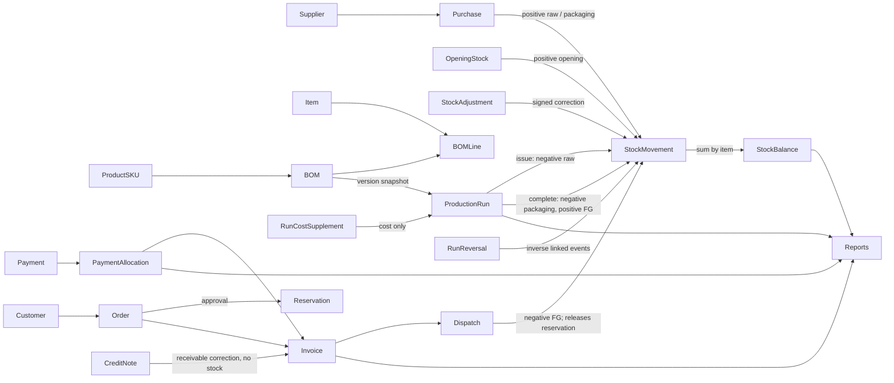

# Decisions and design baseline

19 November 2026. Based on the supplied problem statement (PS), especially §§4–7. These are project decisions, not organizer answers. A reply that changes a decision must also update the requirements and golden workbook. The PS is source material; it does not authorize sending email or publishing this repository.

| ID | Decision | Reason / consequence |
| --- | --- | --- |
| DEC-01 | Moving weighted-average material valuation at each receipt; snapshot issue value | Flour (100×42 + 60×45)/160 = ₹43.125/kg, so 40 kg costs ₹1,725; later receipts cannot rewrite past issues. |
| DEC-02 | Allocate entered run overhead over good output only | ₹1,800/188 absorbs loss into saleable output; zero good output leaves cost unallocated for review. |
| DEC-03 | Benchmark cost ₹5,855/188 = ₹31.143617…; display ₹31.14 and margin ₹18.86 | Includes ₹4,055 materials/packaging and ₹1,800 overhead; margin is ₹50 minus unrounded cost, excluding GST. |
| DEC-04 | Yield = (good−expected)/expected; consumption = (actual issued−BOM standard)/standard | Standard scales by planned batches, not actual good output; default tolerance 3%, flag absolute variance strictly greater than tolerance; zero standard gives N/A. |
| DEC-05 | Record 9 cartons exactly, with a packaging exception note | 188 packets require 10 cartons if all packed; 9 cartons hold 180, leaving 8 loose packets. Do not silently consume a tenth carton. |
| DEC-06 | Provisional output reconciliation: 6 damaged-output equivalents + 6 unexplained process-loss equivalents = 12 yield shortfall | This adopts the user's six-unexplained-packets interpretation; the PS only confirms 6 damaged pouches, not 6 damaged food packets. Keep the assumed output loss split explicitly provisional; never infer another material deduction from it. |
| DEC-07 | Actual pouch issue = 188 used + 6 damaged = 194 | The explicit benchmark closing balance is 306; 200 is the plan, not actual issue. Damaged packaging is tracked separately from food loss. |
| DEC-08 | Available FG = on hand − approved but undispatched reservations | Approval reserves atomically; invoicing retains reservation; dispatch reduces both physical stock and reservation, avoiding overselling. |
| DEC-09 | B remains `submitted` with a computed shortage flag; no partial approval, invoice or dispatch | 120 requested against 88 available shows shortage 32; after replenishment, admin may approve. ?Pending stock? is explanatory text, not a new lifecycle status. Rejection remains a separate explicit admin action. |
| DEC-10 | Invoice creates receivable; dispatch alone moves FG | Documents have different accounting and physical effects; reports use commercial documents as well as stock movements. |
| DEC-11 | Drafts editable with audit; posted events immutable | Invoice correction uses linked credit note; production uses linked reversal and replacement. A credit note alone does not restore physical stock. Reject reversal if dependent stock would become negative until dependencies are resolved. |
| DEC-12 | Money totals in integer paise; quantities in integer g, ml or pieces | Preserve weighted-average unit rates as exact ratios/high-precision decimals: ₹43.125/kg cannot be rounded to paise/kg before multiplication. Round monetary postings half-up once, allocate any residual paise explicitly. |
| DEC-13 | Prototype supply state defaults from customer GSTIN prefix (33 TN, 29 Karnataka); explicit state required without GSTIN | Factory state is 33; same-state uses CGST/SGST, other-state IGST under this exercise. This is a benchmark simplification, not a general legal place-of-supply rule. Tax rate is PS's assumed 5%; HSN/GSTIN use clearly dummy fixture values. |
| DEC-14 | Step 2 posts a material-issue event; step 3 posts completion and packaging issue under the same run | Raw issues happen once at step 2; completion consumes 194 pouches and 9 cartons and receives 188 FG. Run has draft → issued → completed states; each event is atomic/idempotent. No separate WIP stock item in this scope. |
| DEC-15 | Step 8 creates a linked overhead/cost supplement | Late overhead cannot edit existing movements. Cost report moves from provisional materials-only ₹4,055 to final ₹5,855; any eventual inventory valuation adjustment must be a separate auditable value-only event. |
| DEC-16 | Opening FG valuation unknown; no invented opening cost or COGS | PS provides 50 opening packets without a rate. Workbook tests quantities and new-run cost, not aggregate FG valuation or realized accounting profit. |
| DEC-17 | Invoice date is default due date; configurable customer credit days | Ageing uses as-of date minus due date, with current/1–30/31–60/61–90/91+ buckets. Fixture dates are 19 November 2026, so ₹3,875 is current on that date. |
| DEC-18 | Tax calculated per invoice line, half-up to paise; FY April–March | Persist rounded line components and sum them; unique numbering allocated on posting, never reused. Benchmark tax split is exact. |
| DEC-19 | No negative physical stock; reserve and post under transaction locking | Recheck at approval/dispatch/issue, including concurrent requests. Draft edits require renewed approval if they change an approved order. |
| DEC-20 | Sole stretch: shortage-based production suggestion | Use ceil(total uncovered pending demand / BOM expected yield), deduct existing reservations once; B suggests 1 batch (200 expected). Feasible full batches = floor(min(available input / standard per batch)) across raw and packaging inputs. Remaining stock allows 1 batch; 250 uncovered packets need 2, short by 0.5 L oil and 94 pouches. Show needs, stock and warning; never automatically post or reduce the demand-based suggestion. STR-4 is subject to the requirements cut line. |
| DEC-21 | Product-specific carton conversion, separate carton material | A carton sale unit means 20 packets for this SKU; it is not a second automatic packaging-material deduction at dispatch. No mass-to-volume conversion without an explicit item rule. |
| DEC-22 | Run-specific costing first; no month-wide overhead allocation or integrated general ledger | Satisfies the allowed per-run rule and keeps the benchmark explainable; purchase tax is unspecified and is not invented. |

## One-page domain sketch

| Group | Entities and meaning |
| --- | --- |
| Masters | **Item:** stock identity/category/base unit. **UnitConversion:** item-specific rational multiplier. **Product/SKU:** saleable item, pack size, price and tax metadata. **BOM/BOMLine:** versioned recipe, expected yield and standard inputs. **Customer:** sales identity, state and credit terms. **Supplier:** receipt counterparty. |
| Documents | **Purchase/PurchaseLine:** receipt and rate. **ProductionRun/RunIssue/RunOutput:** recipe snapshot, actual inputs, good output and loss. **RunCostSupplement:** later overhead. **Order/OrderLine:** demand, approval and reservation. **Invoice/InvoiceLine:** numbered receivable/tax snapshot. **Dispatch/DispatchLine:** physical fulfillment. **Payment/PaymentAllocation:** receipt applied to invoice. **CreditNote:** invoice correction. **OpeningStock/StockAdjustment:** explicit opening or correction reason. **RunReversal:** inverse of identified run events. |
| Ledger | **StockMovement:** item, signed base quantity, exact unit-cost snapshot where known, source type/ID/line, event ID and posting time; immutable and unique per posting event/line. Opening FG cost may be unknown. Cost supplements hold value without pretending quantity moved. |
| Control | **User/Role:** server-side permissions and salesman ownership. **AuditLog:** actor, time, action, before/after, document reference. **Reservation:** approved order-line quantity awaiting dispatch; **Settings:** tolerance and numbering policy. |

Each document has many lines; each movement belongs to exactly one item and one source event/line. A SKU references one stock item and many versioned BOMs; each run selects one BOM snapshot. Customers have many orders/invoices; dispatch lines reference invoice lines; payment allocations join payments to invoices. Roles have many users; every mutation records its user in AuditLog. This is a conceptual relationship/flow sketch, to be refined into the eventual ≤2-page design note.

Stock is the sum of signed movements. BOM quantities scale by planned batches; actual issues drive stock and cost. Weighted issue values plus actual packaging plus overhead, divided by good output, give run unit cost. Reservations affect availability, never on-hand stock. The application will use a real relational database; framework and hosting choices remain undecided.

## Questions email — draft only, not sent

**To:** Organizer contact, not yet confirmed. **Subject:** Winter Internship 2026 — benchmark and questions-window clarification

Dear CDI internship organizers,

I am preparing the Order-to-Audit prototype. Section 10 of my problem statement still contains date/contact placeholders. Please confirm the questions-window closing date/time (IST), questions email, submission deadline and where shared answers will appear.

1. Should we record exactly 9 cartons for the 188 good packets, noting that 8 packets remain loose and fully packing the output would need 10 cartons?
2. Does “6 pouches damaged” also mean 6 food packets lost? Should the remaining 6 of the 12-packet yield shortfall be recorded as process wastage, or should all 12 remain unclassified food-output loss?
3. For Distributor B's 120-packet order with 88 available, should we partially approve, backorder or reject? I currently plan to keep the whole order submitted with a computed shortage flag of 32.
4. Should packaging issues be suggested from the BOM and confirmed as actual quantities at completion? I plan to deduct 194 pouches and 9 cartons, rather than the BOM's 200 and 10.

Thank you.

**Verification status, 19 November 2026:** The supplied PDF §10 has placeholders. Public search did not establish the questions window or contact; attempts to read the official [application portal](https://apply.nitt.edu) and [CDI site](https://cdi.nitt.edu) failed in the browser tool. No deadline is treated as confirmed. An organizer announcement or reply is still needed; no email has been sent.

## Later README outline

Project purpose → setup/run command and role logins → stack rationale → requirement IDs and delivered tiers → linked design note → seed and benchmark reproduction → expected numbers and explained assumptions → known gaps and stretch status → demo link. At this session's end only planning documents exist; implementation and automated benchmark execution are future work.

## Review additions

Step 5 now has separate approval, invoice and dispatch checkpoints in the workbook. Synthetic seed identities are listed in Inputs; GSTIN-shaped strings and HSN are dummy placeholders, not verified tax identifiers or classifications. The independently reviewed golden values remain typed constants, not formulas. See the README for the carton alert and provisional loss interpretation.
