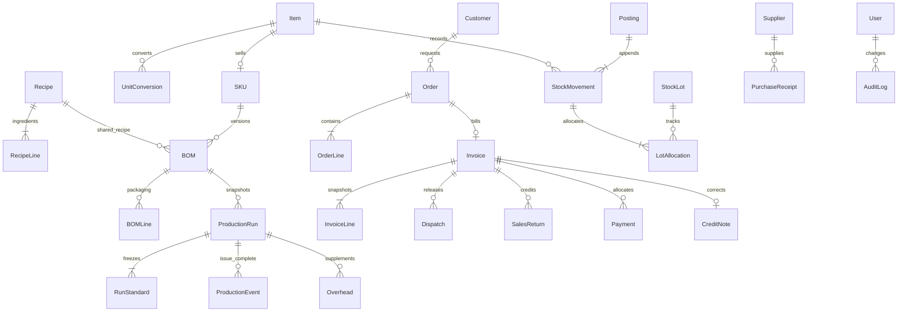

# Order-to-Audit — design note

Runtime: nginx serves React/TypeScript and forwards `/api/` to FastAPI. SQLAlchemy Core owns explicit queries and atomic service transactions; Alembic adopts the unchanged PostgreSQL schema and owns future changes. The runtime has no Django dependency. Earlier Django code remains only as a separate regression oracle. Signed one-hour tokens stay in browser memory; server-side account, role and ownership checks apply to each request.

## Documents and relationships

Each posting references exactly one opening, purchase, production event, dispatch or adjustment header. Each movement references exactly one matching source line; SQL constraints prevent ambiguous links. Opening/purchase → positive movements; raw issue → negative materials; completion → negative packaging plus positive good FG; dispatch → negative FG; adjustment/reversal → signed corrections. Orders, invoices, payments, credits and overhead supplements create no stock movements.

## Posting and lifecycle

Services enforce permissions, begin a PostgreSQL transaction and lock the singleton FactoryControl row. They validate request keys, state, availability and exact arithmetic before committing source lines, one posting sequence and movements together. Retrying the same payload returns the existing document; changed content fails. The single factory lock serializes writers, including reservations and invoice numbering. It is simple to explain and test, but unsuitable for high-throughput multi-factory operation without redesign.

Orders move submitted → approved → invoiced → dispatched. Rejection releases pre-invoice reservations. Availability subtracts unshipped reservations and expired or quality-held lots from on-hand. Partial dispatch retains invoiced status until fulfilled. Full cancellation credit is unpaid/undispatched only; resalable returns separately restore stock and credit original tax/value with cumulative rounding. Invoice drafts receive an FY number only at posting.

Lot allocations partition movements, consuming earliest non-expired batches before unknown-expiry stock; valuation remains item-level weighted average. Reconciliation checks lot sums and nonnegative balances. Legacy lots never invent expiry dates. Customer prices snapshot at submission. Visits and mock fiscal responses are independent append-only records.

Runs move draft → issued → completed. Standards and recipe/BOM versions are snapshotted at creation. Raw issues happen once; completion issues packaging once and receives actual good output. Each SKU has its own expected packet count and packaging BOM while sharing a raw recipe. A 500 g fixture uses 80 expected packets; no special production branch is needed.

## Exact valuation and corrections

Money is integer paise; quantity is integer g, ml or pieces. Decimal-string kg/L/carton inputs use item-specific Fraction conversions before posting and retry comparison; fractional base units are rejected. Half-up rounding occurs at issue totals, tax components and display boundaries. Flour's weighted average after receipt is `(100×42 + 60×45)/160 = ₹43.125/kg`; 40 kg costs ₹1,725. An issue of 1 g from 3 g valued at 10 paise costs 3 paise, leaving 2 g/7 paise; the next costs 4, and depletion takes the final 3.

Benchmark materials cost ₹4,055. Append-only overheads of ₹1,800 give ₹5,855/188 per good packet, displayed ₹31.14; margin at ₹50 is ₹18.86. FG receipts carry materials-only value. Unknown opening FG cost propagates to aggregate FG value and dispatch value; COGS is not invented.

Yield variance is `(good−expected)/expected`; consumption variance is `(actual−standard)/standard`. Absolute variance strictly greater than configurable tolerance flags. Changing tolerance re-evaluates history. Twelve missing packet-equivalents remain unclassified; six damaged pouches are already included in 194 issued pouches.

Movement UPDATE/DELETE is blocked by a database trigger. Posted source freezing is service-level. Adjustments require reasons; reversal appends exact inverses only before dependent stock events and while preserving reservations. Sequence orders valuation; old document dates never insert into history. Independent reconciliation compares each source line, movement and aggregated balance. Audit records capture actor, time and before/after draft edits and state changes.
